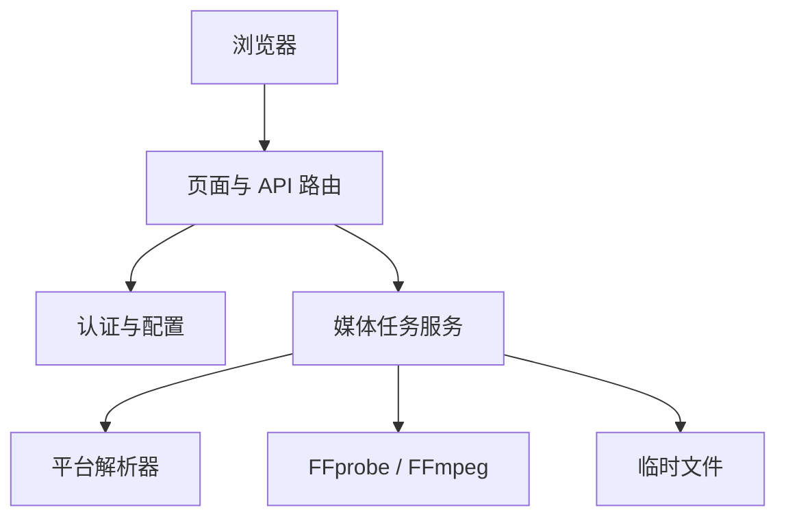

# ARCHITECTURE.md

本文记录项目当前的系统边界、分层和依赖方向。需要改变这些长期约束时，先在 `docs/design-docs/` 记录架构决策。

## 系统概述

音拾为本人和家人提供单视频处理网页。输入为抖音或火山的分享链接、包含分享链接的整段文字，或用户上传的本地视频；输出是原视频完整音轨的 MP3。产品不做 AI 去人声、裁剪或批量处理，也不提供个人账号和历史记录。

应用使用 FastAPI 提供服务端渲染页面和 JSON 接口，Jinja2 渲染 HTML，原生 JavaScript 完成浏览器交互。配置由 `pydantic-settings` 从环境加载；认证由共享密码和签名 Session Cookie 提供。项目不依赖数据库、Redis 或前端构建步骤。部署目标是 Python 3.14 slim 容器，容器安装 FFmpeg/FFprobe 并以非 root 用户运行。

目标是单实例、单进程的家庭使用服务。轻量任务状态暂拟驻留内存，进程重启后不恢复处理中任务；该运行模型仍是候选方案，尚未验证并发、容量和部署行为。当前初始化只提供基础页面与登录能力，媒体处理链路尚未接通。

## 项目结构

```
soundpick/
├── app/
│   ├── main.py                 # FastAPI 应用工厂与当前 HTTP 路由
│   ├── auth.py                 # 共享密码、会话校验、CSRF 与登录限速
│   ├── config.py               # 环境配置与安全校验
│   ├── middleware.py           # 请求体大小限制
│   ├── resolver/               # 平台解析器契约及平台适配器
│   ├── services/               # 预留媒体任务与转换流程
│   ├── templates/              # Jinja2 页面
│   └── static/                 # 原生浏览器脚本和样式
├── scripts/                    # 本地环境准备与配置初始化
├── docs/                       # 需求、架构与维护文档
├── pyproject.toml              # Python 项目及依赖定义
├── requirements.lock           # 运行依赖锁定
└── requirements-dev.lock       # 开发依赖锁定
```

## 分层模型



**依赖规则：**
- 路由层负责 HTTP 校验、认证和响应；业务处理放在服务层。
- 服务层依赖解析器契约和媒体处理能力，不依赖具体页面实现。
- 平台差异封装在 `app/resolver/`，不得让平台解析细节散落在路由或模板中。
- 上传、下载、任务状态与临时目录均由服务层定义边界；当前尚待实现。

## 技术栈

| 层级 | 技术 | 版本/备注 |
|------|------|-----------|
| 运行时 | Python | `>=3.12,<3.15`；项目 mise 配置为 3.14.5 |
| Web | FastAPI、Uvicorn | 服务端路由与 ASGI 服务 |
| 页面 | Jinja2、原生 JavaScript | 不需要 Node 构建 |
| 配置与会话 | pydantic-settings、itsdangerous | 环境配置、签名 Session Cookie |
| HTTP 客户端 | httpx | 平台请求适配 |
| 媒体工具 | FFmpeg、FFprobe | 容器内安装；媒体链路尚未接通 |
| 部署 | Docker `python:3.14-slim` | 最终容器以非 root 身份运行 |

## 模块职责

| 模块 | 职责 | 依赖 |
|------|------|------|
| `app/main.py` | 应用工厂、路由装配、HTTP 输入输出 | 配置、认证、静态与模板资源 |
| `app/auth.py`、`app/middleware.py` | 共享密码会话、CSRF、登录限速和请求体边界 | 配置、Starlette |
| `app/config.py` | 加载和校验运行配置 | pydantic-settings |
| `app/resolver/` | 解析抖音、火山媒体地址的适配器边界 | httpx、resolver 基础契约 |
| `app/services/` | 管理单次提取任务、媒体检查和转码 | resolver、FFmpeg/FFprobe、临时文件系统 |
| `app/templates/`、`app/static/` | 手机优先页面与交互 | 页面/API 契约 |
| `scripts/` | 准备本地环境、安全初始化 `.env` | mise、Python、pip |

## 关键架构决策

初始化实现边界和仍待验证的部署候选见 [`docs/design-docs/initialization.md`](./docs/design-docs/initialization.md)。
