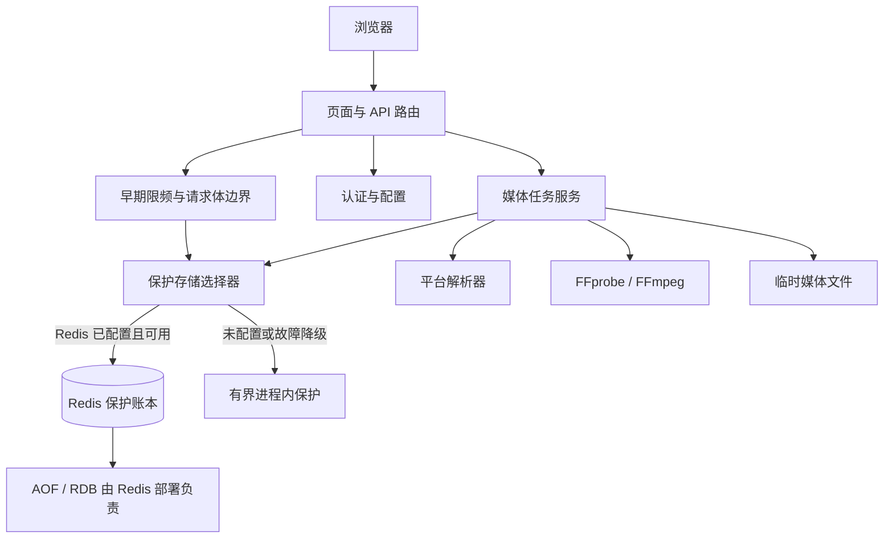

# ARCHITECTURE.md

> 长期约束变更：先在 `docs/design-docs/` 记录架构决策。

## 系统概述

| 边界 | 内容 |
| --- | --- |
| 用户 | 本人与家人；单视频处理网页 |
| 输入 | 抖音 / 火山分享链接或整段文字、本地视频 |
| 输出 | 完整原音轨 MP3、可用的完整原视频 MP4 |
| 范围外 | AI 去人声、裁剪、批量、个人账号、历史记录 |
| Web | FastAPI 页面与 JSON 接口、Jinja2 HTML、原生 JavaScript |
| 配置 / 认证 | pydantic-settings 环境配置；共享密码、签名 Session Cookie |
| 基础设施 | 可选 Redis 保存保护账本；未配置或 Redis 故障时使用有界进程内保护；无前端构建；Python 3.14 slim 容器，内置 FFmpeg / FFprobe，非 root |
| 运行模型 | 单实例、单进程、内存任务；本地任务目录加进程锁；仅一个接收或处理任务；共享 Redis 的部署须使用独立 key prefix |
| 重启 | 不恢复任务；Redis 正常且其 AOF/RDB 持久化可用时保护状态跨重启保留；故障期间的内存额度和限频会丢失 |

- **已验证**：媒体主链路、本地真实 FFmpeg、抖音与当前火山版共用域各一个原音轨样本。
- **待验收 / 限制**：手机真机待完成；旧火山域样本未恢复。
- **证据**：[README](./README.md) · [平台解析](./docs/references/platform-parsing.md)。

## 项目结构

```
soundpick/
├── app/
│   ├── main.py                 # FastAPI 应用工厂与当前 HTTP 路由
│   ├── auth.py                 # 共享密码、会话校验、CSRF 与登录限速
│   ├── config.py               # 环境配置与安全校验
│   ├── middleware.py           # 小请求上限与上传流实际字节边界
│   ├── resolver/               # 分享识别、平台适配与可配置 JSON provider
│   ├── services/               # tasks、media、network、保护账本和公开错误
│   ├── templates/              # Jinja2 页面
│   └── static/                 # 原生浏览器脚本和样式
├── scripts/                    # 本地环境准备与配置初始化
├── docs/                       # 需求、架构与维护文档
├── pyproject.toml              # Python 项目及依赖定义
├── requirements.lock           # 运行依赖锁定
└── requirements-dev.lock       # 开发依赖锁定
```

## 分层模型



**依赖规则：**

- 路由层负责 HTTP 校验、认证和响应；业务处理放在服务层。
- 服务层依赖解析器契约和媒体处理能力，不依赖具体页面实现。
- 平台差异封装在 `app/resolver/`，不得让平台解析细节散落在路由或模板中。
- 上传、下载、任务状态与临时目录均由服务层定义边界。路由只读取受限流，不直接转码。
- 安全网络层将核实的公网 DNS 地址固定至连接，保持原主机的 TLS 验证；媒体子进程仅处理本地文件。
- MP3 / MP4 共用任务 owner、截止时间、活动发送引用。
- 到期拒绝新请求；最后一次发送释放后清理。
- 成功仅留交付产物；失败、取消与启动残留按生命周期回收。
- MP4 可单独降级，保留有效 MP3。

## 技术栈

| 层级 | 技术 | 版本/备注 |
|------|------|-----------|
| 运行时 | Python | `>=3.12,<3.15`；项目 mise 配置为 3.14.5 |
| Web | FastAPI、Uvicorn | 服务端路由与 ASGI 服务 |
| 页面 | Jinja2、原生 JavaScript | 不需要 Node 构建 |
| 配置与会话 | pydantic-settings、itsdangerous | 环境配置、签名 Session Cookie |
| HTTP 客户端 | httpx | 平台请求适配 |
| 媒体工具 | FFmpeg、FFprobe | 要求 libmp3lame；本地路径可配置，容器安装系统工具 |
| 部署 | Docker `python:3.14-slim` | 最终容器以非 root 身份运行 |

## 模块职责

| 模块 | 职责 | 依赖 |
|------|------|------|
| `app/main.py` | 应用工厂、路由装配、HTTP 输入输出 | 配置、认证、静态与模板资源 |
| `app/auth.py`、`app/middleware.py` | 共享密码会话、CSRF、早期限频和请求体边界 | 配置、保护账本、Starlette |
| `app/config.py` | 加载和校验运行配置 | pydantic-settings |
| `app/resolver/` | 分享识别、平台原视频地址适配，排除错误 ID/BGM | 安全网络、resolver 基础契约 |
| `app/services/tasks.py` | 单活动任务、会话所属结果、容量、取消与清理 | media、resolver、network、临时文件系统 |
| `app/services/protection.py` | 北京日成功额度预占/确认/释放、接口限频及 Redis 故障降级 | 可选 Redis、进程内有界保护 |
| `app/services/media.py` | 视频/声音流、时长与完整 MP3 校验、原 MP4 保留或无损封装，子进程回收 | FFmpeg/FFprobe、配置 |
| `app/services/network.py` | 公网 DNS 固定、逐跳校验、有限响应与流式下载 | httpx |
| `app/templates/`、`app/static/` | 手机优先页面与交互 | 页面/API 契约 |
| `scripts/` | 准备本地环境、安全初始化 `.env` | mise、Python、pip |

## 关键架构决策

| 决策 | 约束 | 依据 |
| --- | --- | --- |
| MVP 契约 | 精确接口、容量默认、错误与验收 | [MVP 设计](./docs/active/0.1.0/audio-extraction/design.md) |
| 运行检查 | Web 启动异步验证真实媒体工具与 MP3 编码器；能力接口读取缓存 | [运行与恢复](docs/design-docs/arch-runtime-recovery.md) |
| 网络回退 | 仅连接失败时换用其他已校验公网地址；逐跳隔离 Cookie 与连接池 | 同上 |
| 浏览器恢复 | `sessionStorage` 仅保存当前任务 ID 与确认 / 取消标记；刷新查询，不重传 | 同上 |
| 恢复边界 | 不保存媒体、分享内容或历史；服务器重启不恢复任务 | 同上 |
| 生产额度与防刷 | 北京日全站成功 10 首；Redis 可用时共享持久保护状态，故障时有界内存降级；媒体历史不落库 | [生产额度与防刷](docs/design-docs/arch-production-protection.md) |
| 双媒体交付 | 同一任务；不增加网络抓取或持久存储；临时交付见下述任务决策 | [MP4 设计](./docs/active/0.1.0/video-download/design.md) |

## 审查修复后的约束

依据：[任务确认与可测试性决策](docs/design-docs/arch-review-hardening.md)。

| 约束 | 实现边界 |
| --- | --- |
| 任务 | 可恢复预约上传、幂等取消、完整画面校验、回归入口 |
| 平台登记 | 单一 `PlatformSpec` catalog：ID、域名、名称、Adapter 工厂；Web 装配与任务选择共用 |
| 交付元数据 | 集中于 `app/services/artifacts.py` |
| 浏览器 | 任务控制、视图、文件分享三个原生模块；无前端构建 |
