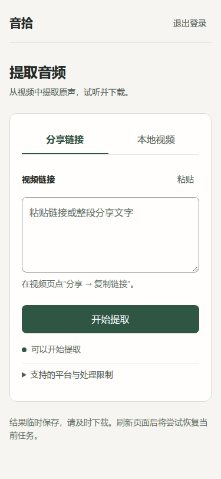
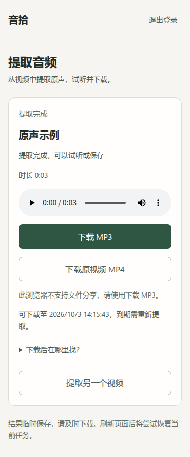
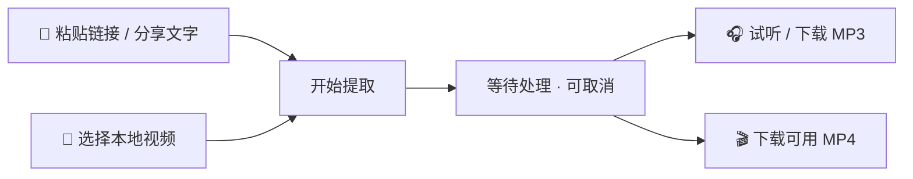

<div align="center">


# 音拾 · soundpick

**从短视频中拾取完整原声，试听并保存。**

📱 手机优先 · 🔗 抖音 / 火山分享 · 📂 本地视频<br>
🎧 完整原音轨 MP3 · 🎬 可用的原视频 MP4 · 👪 本人与家人使用


[快速开始](#快速开始) · [功能](#功能) · [配置](#配置) · [开发](#开发) · [文档](#文档)

</div>

## 预览

<div align="center">


</div>

截图来自本地 Chromium；结果页使用合成视频，展示实际处理流程。

## 功能

| 能力 | 说明 |
| --- | --- |
| 🔗 分享解析 | 链接或整段分享文字；按目标视频 ID 获取原视频 |
| 📂 本地上传 | 流式接收、上传进度；校验大小、时长及音视频流 |
| 🎧 原音轨 | 第一条完整声音轨道 → 192 kbps MP3；禁止用 music/BGM 替代 |
| 🎬 原视频 | MP4 保留原字节；其他容器尝试无损封装；失败仍保留有效 MP3 |
| ⬇️ 试听与保存 | 原生播放器、Range、中文文件名；支持时提供系统文件分享 |
| ⏳ 任务控制 | 进度、取消、断线重连、当前标签页刷新恢复 |
| 🔒 临时数据 | 共享密码；任务与文件绑定创建会话；媒体结果到期清理 |

- **并发**：每实例一个接收或处理任务；繁忙时不排队。
- **范围外**：个人账户、历史、批量、裁剪、AI 去人声。

| 验收边界 | 状态 |
| --- | --- |
| 抖音 / 当前火山版 | 各一个实网样本通过；不保证所有链接可用 |
| 旧火山域 | 样本未恢复；解析失败可改用本地上传 |
| 手机保存 / 系统分享 / 新版容器 | 待单独验收，见[记录](#验证状态) |

> 平台可用性受链接状态与访问策略影响。

## 技术栈

| 层级 | 技术 |
| --- | --- |
| 服务端 | Python 3.12–3.14 · FastAPI · Uvicorn |
| 页面与交互 | Jinja2 · 原生 JavaScript（ES Modules）· CSS |
| 配置与会话 | pydantic-settings · 签名 Session Cookie · CSRF 校验 |
| 平台请求 | httpx · 公网地址校验 · DNS 固定连接 |
| 媒体处理 | FFmpeg / FFprobe · libmp3lame |
| 工程检查 | pytest · coverage.py · Ruff · Playwright / Chromium |
| 容器 | Docker Compose · 非 root · 只读根文件系统 |

- Redis（可选）保存每日成功额度与短期限频事件；Redis 不可用或未配置时使用有界进程内保护，不保存媒体历史。无前端构建。
- Node 22：仅用于前端与浏览器检查。
- 系统边界：[ARCHITECTURE.md](ARCHITECTURE.md)。

## 快速开始

### 前置条件

- Linux / WSL 与 [mise](https://mise.jdx.dev/)，按 `.mise.toml` 准备运行时；项目开发环境固定为 Python 3.14.5。
- 可实际运行的 FFmpeg、FFprobe，且 FFmpeg 包含 `libmp3lame` 编码器。

> `setup.sh` 仅安装 Python 项目依赖；mise、运行时与媒体工具须预先准备。

### 安装与启动

在仓库根目录运行：

```bash
./scripts/setup.sh
.venv/bin/python scripts/init_env.py
make runtime-check
make dev
```

访问 **http://127.0.0.1:8000**，使用项目根目录 `.env` 中的 `APP_PASSWORD` 登录。

- 初始化：生成随机密码与会话密钥；不覆盖已有 `.env`。
- 密码：仅在本机查看；勿提交 `.env` 或贴入日志。

如果系统工具不在 PATH 中，在 `.env` 配置绝对路径后重启：

```dotenv
FFMPEG_BIN=/absolute/path/to/ffmpeg
FFPROBE_BIN=/absolute/path/to/ffprobe
```

| 运行检查 | 行为 |
| --- | --- |
| 启动检查 | 实际执行 FFmpeg / FFprobe，验证 MP3 编码器 |
| 未就绪 | 页面可访问；创建任务返回 503 |
| 本地诊断 | `make runtime-check`；分别报告媒体工具与 Redis 状态 |
| Redis 未配置 | 自检说明使用内存保护，不尝试连接 Redis |
| Redis 已配置 | 按原超时执行只读 Lua/MEMORY 探测，不修改额度、预约或限频状态 |
| 自检退出码 | 媒体及配置的 Redis 检查通过返回 0；任一失败返回 1，Redis 故障仍允许应用启动并降级 |

- Python 依赖有变更时重新运行 `./scripts/setup.sh`；仅设置 `REDIS_URL` 不能补齐缺失的客户端。
- Redis 失败日志和自检使用固定 `reason` 分类：`client_unavailable`（客户端无法导入）、`timeout`（超时）、`authentication`（认证失败）、`permission`（权限不足）、`connection`（连接失败）。不输出连接串或原始异常。
- 只读检查通过不证明写入权限、Redis 持久化或连接长期稳定。间歇建连超时应检查链路与 Redis 入口；增加超时会延长同步等待，不能代替定位。

### 使用



- **刷新**：浏览器允许存储时，同一标签页重新查询当前任务；不重传、不存历史。
- **及时下载**：关闭标签页、退出登录或结果到期后，不保证保留入口。

## 容器运行

先用初始化脚本创建 `.env`，再运行：

```bash
docker compose up --build -d
docker compose logs -f app
```

| 容器配置 | 默认值 |
| --- | --- |
| 访问 | http://127.0.0.1:8000，仅绑定回环地址 |
| 媒体工具 | 内置 FFmpeg / FFprobe；覆盖本机工具路径 |
| 运行 | `soundpick-data` 命名数据卷、单应用进程、日志轮转；媒体任务随本地卷管理，保护账本优先使用 Redis |

对外部署需要 HTTPS 入口，并在 `.env` 设置：

```dotenv
APP_ENV=production
COOKIE_SECURE=true
```

- **进程**：仅一个 Uvicorn worker；同一数据目录受进程锁保护。
- **保护存储**：配置 `REDIS_URL` 并为 Redis 启用 AOF 或 RDB 持久化，可在正常连接时跨重启保留额度与限频；持久化由 Redis 实例负责。Redis 不可用时服务继续运行并降级到进程内限额，故障期间的限额是软保护，进程重启会丢失这部分内存状态。未配置 `REDIS_URL` 时始终使用进程内保护。
- **Redis 配置**：`REDIS_KEY_PREFIX` 默认 `soundpick:{protection}`；共享 Redis 的不同部署应使用不同 prefix；同一 prefix 不支持多个应用实例。进程内单实例锁仍然适用。 若启用 Redis ACL，需允许 `MEMORY USAGE`，供额度账本读取前的占用预检使用；无权限时自动降级到内存。
- **Redis 超时边界**：0.1 秒分别约束连接和 socket 操作，并非请求总耗时；DNS 解析和多地址尝试可能额外耗时，建议使用服务器已有 Redis 的稳定内网地址。
- **反向代理**：Docker 默认关闭 Uvicorn 代理头解析。默认按代理连接的 peer 地址识别客户端，代理后的请求会聚合计入同一 IP 限额。仅在可信代理拓扑下，才显式使用 `--proxy-headers --forwarded-allow-ips=<精确peerIP或CIDR>`；同时限制源站直连，并确保代理覆盖客户端传入的 `X-Forwarded-For`。不要使用 `*`。
- **跨设备**：须自行配置网络入口。
- **非 HTTPS 局域网**：分享、剪贴板可能不可用；下载入口仍可用。

容器环境的历史验证及其版本边界见[容器验证记录](docs/references/container-verification.md)。

## 配置

完整变量见 [.env.example](.env.example)。环境变量优先于 `.env`。

| 变量 | 默认值 | 用途 |
| --- | --- | --- |
| `APP_PASSWORD` | 初始化生成 | 共享访问密码，12–128 字符 |
| `SESSION_SECRET` | 初始化生成 | 会话签名密钥，至少 32 字符 |
| `APP_ENV` / `COOKIE_SECURE` | 初始化为 `local` / `false` | 生产环境必须使用 `production` / `true` 与 HTTPS |
| `DATA_DIR` | `data` | 媒体工作目录 |
| `REDIS_URL` | 空 | 可选 `redis://` / `rediss://` 连接 URL；查询参数仅允许 `db`；未设置时使用进程内保护 |
| `REDIS_KEY_PREFIX` | `soundpick:{protection}` | 此部署在 Redis 中使用的保护数据前缀 |
| `REDIS_TIMEOUT_SECONDS` | `0.1` | Redis 连接与套接字超时；客户端不自动重试 |
| `REDIS_RETRY_SECONDS` | `30` | Redis 故障后探测恢复的冷却秒数 |
| `REQUEST_BODY_TIMEOUT_SECONDS` | `15` | 普通请求体接收总超时，范围 1–60 秒 |
| `MAX_MEDIA_BYTES` | `209715200` | 单视频 200 MiB |
| `MAX_DURATION_SECONDS` | `1800` | 最长 30 分钟 |
| `UPLOAD_TIMEOUT_SECONDS` | `300` | 上传时限 5 分钟 |
| `TASK_TIMEOUT_SECONDS` | `600` | 处理时限 10 分钟 |
| `RESULT_TTL_SECONDS` | `3600` | 结果保留 1 小时 |
| `MAX_RETAINED_TASKS` | `32` | 最多保留的任务数，含失败和取消 |
| `APP_PORT` | `8000` | Compose 的本机映射端口；`make dev` 固定为 8000 |

| 数据与临时媒体 | 策略 |
| --- | --- |
| 保护账本 | 配置 Redis 时使用 Redis；否则使用有界进程内状态。不会自动读取或删除旧 SQLite 文件 |
| 目录 | `DATA_DIR/.soundpick-tasks/` |
| 成功 | 仅保留交付用 MP3 与可用 MP4 |
| 失败 / 取消 / 到期 | 清理；已开始的文件发送结束后再回收目录 |
| 重启 | 不恢复任务；启动清理本应用残留 |

每日成功额度为北京时区全站 10 首；pending 预约跨日仍占额度，成功归完成日，失败、取消、预约超时及重启中断释放预约。正常连接 Redis 时，成功记录保留最近 7 天，限频事件最长保留 1 小时。Redis 故障时保留本进程已知的成功额度与活动预约；限频继续由内存窗口约束，但限频状态不回灌 Redis。Redis 恢复时以 Lua 原子合并成功任务 ID 与当前 pending；若合并后已超额，则阻止创建新任务。Redis 故障期间额度属于软保护，进程重启可能丢失内存记录并暂时超过每日 10 首。

| 请求组 | 单 IP | 全站 |
| --- | --- | --- |
| 登录 | 10 次/分钟、30 次/15 分钟 | 60 次/分钟、300 次/15 分钟 |
| 提取 | 6 次/分钟 | 20 次/分钟、30 次/小时 |
| 上传 | 6 次/分钟 | 20 次/分钟 |
| 轮询、能力、取消 | 120 次/分钟 | 600 次/分钟 |
| 下载（含 HEAD、Range） | 30 次/分钟 | 120 次/分钟 |

直接上传同时计入提取与上传。限频在读取请求体前执行；失败请求仍计频。429 响应提供 `Retry-After`，JSON 同时提供 `retry_after`。

进程内防刷限频最多跟踪 4096 个桶，额度记录另设 4096 条上限；达到上限后拒绝无法安全跟踪的新 key，不通过淘汰旧 key 来绕过限额。

### 可选解析服务

设置 `DOUYIN_PARSER_URL`、`HUOSHAN_PARSER_URL` 和可选 `PARSER_API_TOKEN`，可接入固定 JSON 解析端点：

```http
GET <endpoint>?url=<分享链接>
```

```json
{"video_url": "https://example.com/original-video.mp4", "title": "视频标题", "author": "作者"}
```

- **可选字段**：`title`、`author`；`author` 可为含 `name` 的对象。
- **令牌**：仅发给固定端点；不跟随跳转，不写入 URL。
- **返回地址**：仍校验公网地址、跳转与容量。
- **来源**：接入前确认目标原视频；禁止用背景音乐地址冒充。

## 开发

```bash
make test           # Python 回归，要求真实媒体工具，缺工具直接失败
make coverage       # Python 语句与分支覆盖，综合门槛 85%
make lint           # Ruff 检查与格式检查
make ui-check       # JavaScript 语法与受控异步交互回归
make browser-check  # 独立 HTTP 服务 + Chromium + 真实媒体，默认重复 5 轮
```

- `make test` / `make coverage`：自动读取媒体工具配置。
- 局部检查：`.venv/bin/python -m pytest tests/test_auth.py`。
- 直接 pytest 缺工具可能跳过真实媒体测试；跳过不等于完整验收。

浏览器回归需要 Node 22、Playwright 模块和 Chromium。使用现有工具时可指定：

```bash
SOUNDPICK_PLAYWRIGHT_MODULE=/absolute/path/to/playwright \
SOUNDPICK_CHROMIUM_BIN=/absolute/path/to/chromium \
mise exec -- make browser-check
```

| 检查选项 | 约束 |
| --- | --- |
| `SOUNDPICK_NODE_BIN` | 必要时指定 Node 路径 |
| `SOUNDPICK_BROWSER_REPEAT` | 大于 1 的整数；默认 5 轮 |
| 浏览器隔离 | 每轮独立回环进程、临时目录与内存限频；测试子服务显式禁用 Redis，不使用部署账本 |
| Redis 隔离回归 | 真实 HTTP 与浏览器检查注入本地 Redis 连接陷阱，确认测试子服务不连接继承的 Redis 地址 |
| 覆盖率 | `work/coverage/`（已忽略）；不含 JavaScript 和媒体子进程内部 |

依赖锁定在 `requirements.lock` 和 `requirements-dev.lock`。修改 `pyproject.toml` 后须同步重新解析锁文件。

### 目录结构

```text
app/
├── main.py          # 应用工厂、页面与 HTTP 接口
├── auth.py          # 会话、CSRF 与登录限速
├── config.py        # 配置与校验
├── middleware.py    # 请求体与上传容量边界
├── resolver/        # 平台识别与原视频解析
├── services/        # 任务、媒体、网络与文件交付
├── templates/       # Jinja2 页面
└── static/          # 浏览器模块、样式与图标
scripts/             # 环境初始化与检查入口
tests/               # Python、交互与浏览器回归
docs/                # 需求、设计与验收证据
```

### 验证状态

> 本地测试、真实媒体、平台实网、容器与手机验收不能互相替代。

| 证据 | 记录 |
| --- | --- |
| Python / 覆盖率 / 浏览器交互 | [工程验证](docs/references/system-optimization-verification.md)，含前轮摘要 |
| 媒体完整性 / 下载 / 生命周期 | [原音轨](docs/active/0.1.0/audio-extraction/acceptance.md) · [MP4](docs/active/0.1.0/video-download/acceptance.md) |
| 实网样本 / 平台限制 | [平台解析](docs/references/platform-parsing.md) |
| 设备 / 容器与待验收项 | [手机](docs/active/0.1.0/audio-extraction/mobile-acceptance.md) · [容器](docs/references/container-verification.md) |

## 文档

- [已确认需求](docs/requirements.md)：用途、范围与产品约束。
- [架构](ARCHITECTURE.md) · [安全策略](docs/SECURITY.md) · [可靠性标准](docs/RELIABILITY.md)。
- [活跃版本](docs/active/index.md) · [设计决策](docs/design-docs/index.md) · [技术债](docs/active/tech-debt-tracker.md)。
- [贡献与协作约定](AGENTS.md)：修改范围、工程命令与验收边界。
