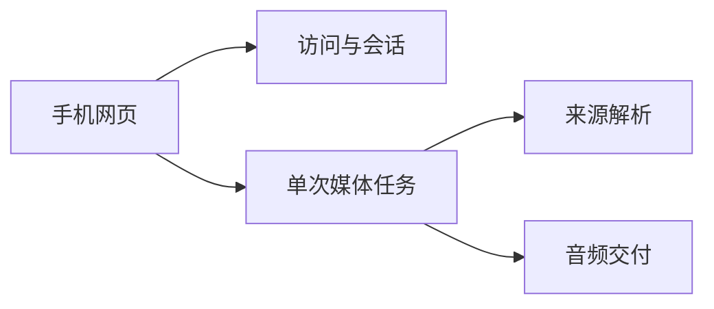

# 业务领域划分

本文标明功能应落入的业务边界；技术分层和依赖方向见 [ARCHITECTURE.md](../ARCHITECTURE.md)。

## 领域清单

| 领域 | 职责 | 代码位置 | 关键数据 |
|------|------|----------|----------|
| 访问与会话 | 共享密码登录、会话与页面访问控制 | `app/main.py`、`app/auth.py`、`app/config.py` | Session、CSRF token |
| 来源解析 | 识别抖音和火山分享内容并定位原视频媒体 | `app/resolver/` | 分享文本、媒体地址 |
| 单次媒体任务 | 接收一个链接或上传视频，检查媒体并生成完整音轨 MP3 | `app/services/` | 任务状态、临时输入、临时输出 |
| 音频交付 | 试听与授权下载结果，到期回收结果文件 | `app/main.py`、`app/services/` | 临时 MP3 |
| 手机网页 | 链接/文本输入、文件上传、结果播放和保存交互 | `app/templates/`、`app/static/` | 浏览器内的当前操作状态 |

所有媒体数据均为临时数据，产品不维护处理历史或个人账户。

## 领域关系

## 领域通信规则

- HTTP 认证和请求校验在路由边界完成。
- 路由调用服务接口，不直接实现媒体获取或转码。
- 来源平台差异由解析器适配器封装，媒体任务只依赖统一解析结果。
- 单个任务处理一个输入，不新增历史查询或批量入口，除非产品需求明确变化。
