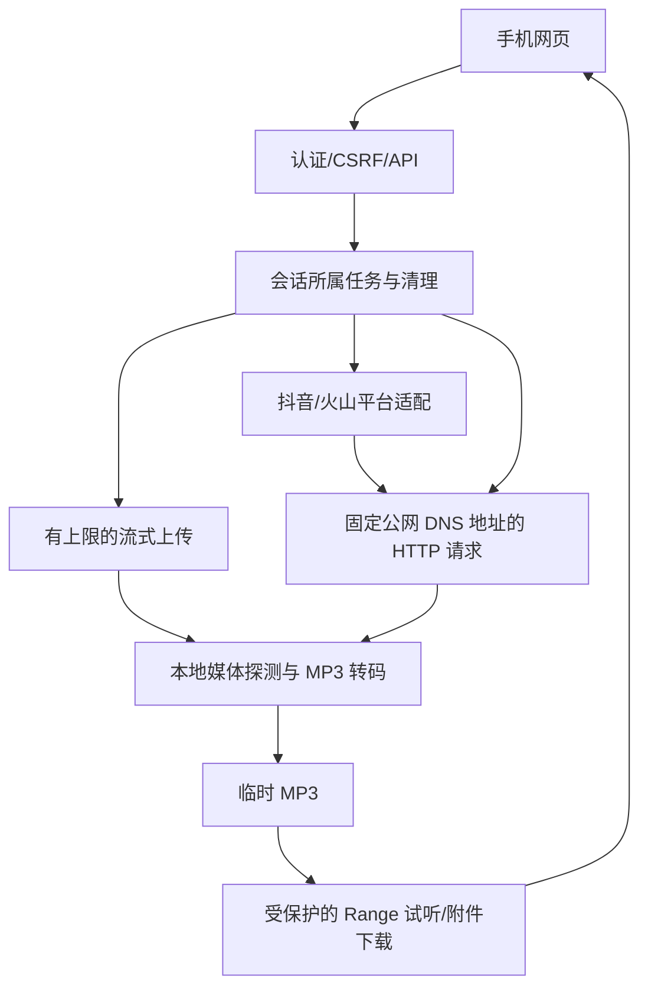

# MVP 技术设计

逻辑版本：0.1.0；行为契约见 [spec.md](./spec.md)。

设计已与当前实现核对；`verified` 不代表真实平台、手机或容器的完整验收，待验收行为仍按规格记录。

2026-10-03 原视频 MP4 下载新增接口、字段和临时文件策略见 [补充设计](../video-download/design.md)。下述音频契约保持兼容，原视频保留与双文件交付以补充设计为准。

## Context / Goal / Non-Goal

现有共享密码、CSRF、页面骨架可用，尚无媒体链路。目标是连通两种输入到完整 MP3 并通过来源逐项验收。保持单进程家庭用途，无账户、历史查询、数据库、Redis、前端构建或持久任务队列。

## Architecture

- `app/services/network.py`：URL/DNS 校验、逐跳重定向、TLS/Host 保持原始主机且连接固定经核实的公网 IP；不使用环境代理。下载与页面响应逐块计数。
- `app/resolver/`：平台域名登记、分享文本规范化、网页适配及可配置 provider；只取视频地址。拒绝 music/BGM 地址；输出不含 cookie/token。
- `app/services/media.py`：仅本地文件探测、视频/声音流与时长校验、FFmpeg 完整转 MP3、产物时长检查。子进程无 shell，限制协议为 file/pipe；超时/取消杀死并回收子进程。
- `app/services/tasks.py`：内存任务，接收和处理共享一个繁忙槽位，最多 32 个保留结果；输入用随机目录，文件权限私有。生命周期取消处理、周期过期回收、下次启动移除本应用专属残留目录。仅单 worker；不宣称多实例安全。
- 原始 body 上传避免 multipart 全量缓冲，前端直接发送 File；小请求继续早期限制，上传按实际传入块计数。认证/CSRF 在读取上传前完成。

## Interface Contract

错误保持 `{detail: string}`，可加 `code: string`；不输出上游响应/密钥/原始异常。写请求使用 `X-CSRF-Token`。

| 接口 / 对应 Behavior | 输入 | 成功返回 | 失败 / 幂等语义 |
|---|---|---|---|
| GET /api/capabilities / 创建输入任务 | 无 | extraction_available, planned_inputs, platforms, limits, media_available | 未登录 401；平台可用表示已配置路径，实网验收单独报告 |
| POST /api/tasks/reservations / 预约本地视频任务 | JSON `{task_id,filename?}`，32位小写hex ID | 202 TaskView | 同owner同ID同上传类型幂等；其他owner404；跨输入类型409；401/403/400/409/503 |
| POST /api/tasks/{id}/upload / 向预约上传 | 原始视频流 | 202 TaskView | 401/403/404；非接收状态或重复上传409；超限413、超时408 |
| POST /api/tasks/upload / 兼容旧创建入口 | body=单个视频二进制；filename 查询参数≤200字符 | 202 TaskView | 401/403；空文件400、超限413、媒体工具缺失503、忙409；非幂等 |
| POST /api/tasks/link / 创建分享内容任务 | JSON `{share_text: string, task_id?: string}` 1–4096字符 | 202 TaskView | 401/403、无效输入400、不支持422、忙409、工具缺失503；同owner同ID同规范化链接幂等，跨类型或不同链接409 |
| GET /api/tasks/{id} / 查看进度 | id=32位随机十六进制 | 200 TaskView | 401；其他会话/不存在/过期404；只读 |
| POST /api/tasks/{id}/cancel / 取消处理 | 无 | 200 TaskView | 401/403/404；重复取消幂等；终态保持 |
| GET或HEAD /files/{id} / 试听与保存 | download=0或1，Range 标准请求头 | 200/206 audio/mpeg；inline或attachment UTF-8安全文件名 | 401/404、未完成409、非法范围400/416；只读 |

任务所属会话在成功登录时生成随机 owner，签名 Cookie 保存；共享密码不意味着不同浏览器能枚举任务。密码变化后旧认证失效。

capabilities schema：`{extraction_available: bool, media_available: bool, planned_inputs: string[], platforms: [{id: string,name: string,available: bool,configured: bool}], limits: {max_media_bytes:int,max_duration_seconds:int,result_ttl_seconds:int,upload_timeout_seconds:int}}`；available/configured 仅表示启用路径，不表示链接一定可解析，页面逐任务呈现实际结果。

浏览器在创建前生成任务ID；文件输入先预约再向已知ID上传。接收阶段中止XHR后仍请求服务端取消，响应丢失时通过同ID查询恢复，未确认不宣称停止。预约幂等、接收期限及旧接口兼容规则见[任务确认决策](../../../design-docs/arch-review-hardening.md)。

平台替换契约：`async MediaResolver.resolve(url: str) -> ResolvedVideo`；失败用可读的解析错误。可配置 provider 接口 GET `url=<share_url>`，返回 `{video_url: string, title?: string, author?: string}`，可用 Bearer token；仅固定配置端点接收密钥，不向重定向地址转发。真实 provider 需提供文档/端点和样本后核对映射。内置网页路径按公开页面证据实现，不承诺绕过验证/登录限制。

内部公共契约在 T1 冻结：

- `ResolvedVideo(video_url: str, title: str='', author: str='', original_audio_url: str|None=None)` 沿用基线；MVP 一律下载 video_url，不使用音频候选。
- `MediaError(message: str, code: str='media_error', status: int=422)` 用于可公开失败；解析失败 code=resolve_failed，网络失败 network_error，时长越界 duration_limit；取消使用 asyncio.CancelledError，不包装为成功。
- `SafeHTTP.fetch(url: str, *, max_bytes: int=2097152, headers: dict|None=None, follow_redirects: bool=True) -> HTTPPage(url:str,status:int,headers:dict,body:bytes)`；失败 MediaError。
- `SafeHTTP.download(url: str, target: Path, max_bytes: int) -> None`：有上限的流写本地；失败不留部分文件。
- `MediaProcessor(settings: Settings).available: bool`；`async extract_audio(source: Path, target: Path) -> float`：返回产物时长秒数，失败 MediaError；对比源第一条音频流时长（缺失时用容器时长）与MP3时长，允许编码填充差 max(0.25, min(2, duration*0.005)) 秒；负责magic/视频+音频/时长/完整性检查，不负责删除source；取消必须回收子进程。配置名 `ffmpeg_bin`/`ffprobe_bin`、`max_duration_seconds`、`max_media_bytes`、`task_timeout_seconds`。
- `TaskManager(settings, media, resolvers, network)` 暴露 reserve(owner,title)->Task、start(task,share_url=None)、get(id,owner)->Task、async cancel(task)、async receive(task,stream)、view(task)->dict、async sweep()/close()。同步reserve先占繁忙槽，防止并发接收绕过限制；start不排队。Task 状态只由manager修改。

## Data Model

Task 内部：id/owner:string，state=receiving/resolving/downloading/converting/ready/failed/cancelled，title/author/message:string，目录:Path，duration:float|null，expires_at:UTC timestamp，asyncio runner，delivery引用计数。无数据库/索引；字典按 id 查询，owner 匹配后才能响应。

TaskView：`{id,state,message,title,author,duration_seconds,expires_at,preview_url,download_url,filename}`；字符串字段，duration_seconds 为 float|null，expires_at 为 UTC Unix 秒数 float|null，结果链接/文件名为 string|null。结果 URL/filename 仅 ready 状态返回；不返回内部路径/媒体地址。

所有终态（ready/failed/cancelled）均在终态进入时设置保留截止时间；到期删除元数据，字典总数上限32，失败/取消同样计数。不存在/过期统一404 `{code:'task_missing',detail:'任务不存在或已过期，请重新提取'}`，前端保留已知截止时间并给相同重新提取指引，不要求后台历史或tombstone存储。

## Non-Functional Requirements

| 维度 | 默认指标 / 依据 |
|---|---|
| 容量 | 输入200 MiB、1800秒；同时接收/处理1个，结果最多32个，MP3 192kbps；家庭用途，可配置 |
| 时间 | 上传300秒、处理600秒、单次HTTP30秒、清理周期30秒；结果3600秒到期后停止新下载 |
| 边界 | 小body16KiB；页面/解析响应2MiB；逐跳≤5；只接受公网http(s)80/443，拒绝私网/混合DNS/嵌入用户信息 |
| 文件 | 随机任务目录；不用输入文件名拼路径；探测容器magic和视频/声音流；输出MP3与可用MP4 |
| 生命周期 | 成功仅保留交付产物；异常/取消删全目录；过期无任一活跃文件响应时回收；关闭停止任务；重启清残留 |
| 服务范围 | 单实例单进程，重启不恢复在途任务；无SLA/P95承诺，测得结果单列 |

## Error Handling

平台登录/验证/失效：任务 failed，可提示改上传；不猜 BGM。DNS/HTTP超时/状态异常/响应超限：failed，取消子进程并删除输入。无媒体工具：新任务503，能力报告不可用。损坏媒体/无视频/无声音/时长超限：可读失败。磁盘异常：通用失败，不露内部路径。容量不足或满32结果：409并提示等待到期。取消/超时：先停止 runner/子进程，再清理。发送中的文件引用保护，响应完成或断开后释放；到期不接受新文件响应。

## Alternatives Considered

| 方案 | 优点 | 代价 / 决定 |
|---|---|---|
| 同步等待完整提取 | 接口少 | 手机长等待/代理超时，选异步任务轮询 |
| 队列/数据库 | 恢复及多实例 | 家庭MVP无需，暂不引入 |
| 平台music字段 | 易获得音频 | 无法证明完整原音轨，禁止 |
| multipart UploadFile | 常见 | 解析前可能缓冲超大body，选择受限原始流上传 |

## Testing Strategy

| 对象 | 证据 | 通过条件 |
|---|---|---|
| 创建输入/能力 | 认证API测试、真实FFmpeg生成有画面和音频样本 | 能力与工具一致；MP3时长符合编码填充容差且真实生成样本首尾标识音均可解码；输入最终删除 |
| 平台分享 | URL/页面fixture测试+真实抖音和火山样本 | URL精确识别、不取BGM；实网视频可下载转完整MP3 |
| 任务/取消 | 集成测试和时间边界测试 | 繁忙409；会话隔离；取消子进程退出、目录删除 |
| 文件响应 | 实际HTTP下载/HEAD/Range测试 | MPEG类型、UTF-8 attachment；206字节正确；404/401隔离 |
| 清理/异常 | 临时目录测试、短保留时间 | 成功删输入、失败删全部、过期/重启删除、不删无关文件 |
| 手机/桌面/分享 | 窄屏及桌面浏览器检查、文件分享能力分支、真机记录 | 大按钮、无水平溢出、桌面输入试听下载、进度/错误清楚，支持时用户点击分享，不支持有下载指引 |

## Milestones

1. 契约、媒体工具与任务基础；2. 分享解析及安全下载；3. Web/API手机交互；4. 实网样本、真实转码和生命周期验收。缺外部样本或平台配置时仍完成其他链路，保留整体验收未完成。
