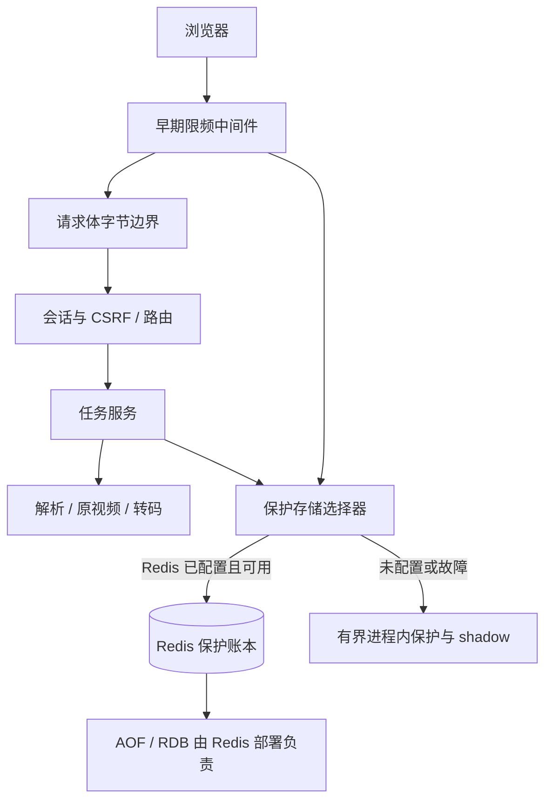

# 生产额度与防刷 Design

**Version:** 0.1.0

## Context / Goal / Non-Goal

目标是维持北京时区全站每日成功 10 首及各接口限频，并在 Redis 不可用时让服务继续运行。Redis 是可选的共享持久存储；未配置时使用有界进程内保护。单实例、单进程、单活动任务、会话 owner、上传流边界和媒体生命周期保持不变。

不覆盖多应用实例共享同一保护命名空间、公网带宽级 DDoS 防护、媒体历史或个人账户。Redis 的 AOF/RDB 持久化由其部署者负责。旧 SQLite 文件不迁移，也不自动删除。

## Architecture

应用仅使用 ASGI client 地址作为请求 IP 身份来源。默认容器关闭 Uvicorn 代理头解析；可信代理部署须显式配置准确 peer IP/CIDR、覆盖客户端转发头并限制源站直连；禁止信任 `*`。

## Configuration

| 配置 | 默认值 | 约束 |
| --- | --- | --- |
| `REDIS_URL` | 空 | 可选；空值使用纯内存保护 |
| `REDIS_KEY_PREFIX` | `soundpick:{protection}` | 每个部署独立；共享 Redis 的其他部署须使用不同 prefix |
| `REDIS_TIMEOUT_SECONDS` | `0.1` | 连接和套接字超时；客户端不自动重试 |
| `REDIS_RETRY_SECONDS` | `30` | Redis 故障熔断后的恢复探测冷却时间 |

同一 prefix 不可由多个应用实例共享。应用配置 Redis 连接与 socket 操作超时，不因 Redis 故障停止服务。

## Interface Contract

| Behavior | 接口 | 契约变化与验证 |
| --- | --- | --- |
| 全站每日额度 | POST `/api/tasks/link`，JSON `share_text:str(1..4096)`、可选32位hex `task_id`；POST `/api/tasks/reservations`，JSON `task_id`、`filename:str≤200`；POST `/api/tasks/upload?filename=...` | 保持202和Task视图；预占每日额度；输入一致的现存任务不重复预占；额度不足429 `daily_quota`；成功 ID 冲突409 `input_conflict` |
| 接口防刷 | POST `/login` | 原成功303、失败400/401/403；超限429，HTML提示及 `Retry-After` |
| 接口防刷 / 输入与会话边界 | POST `/api/tasks/{task_id}/upload`，原始字节；直接上传同上 | 上传独立限频；直接上传同时消耗提取与上传预算；保留原202、413、401/403/404/409；在读取体前执行限频 |
| 接口防刷 / 输入与会话边界 | GET `/api/tasks/{task_id}`；POST `/api/tasks/{task_id}/cancel` | 保留Task视图；轮询桶限频；跨会话404 |
| 接口防刷 / 输入与会话边界 | GET/HEAD `/files/{task_id}?kind=audio或video&download=bool`，允许Range | 保留文件响应和生命周期；独立下载桶；跨会话404 |
| 接口防刷 | GET `/api/capabilities` | 使用轮询桶；增加 `daily_success_limit=10`，保留原能力结构 |

所有 JSON 限额错误为429，包含 `code` 和 `retry_after:int>=1`；HTTP 头 `Retry-After` 与该值一致。错误密码、CSRF 失败和无效输入仍计频。

| 请求组 | 单 IP | 全站 |
| --- | --- | --- |
| 登录 | 10次/分钟、30次/15分钟 | 60次/分钟、300次/15分钟 |
| 提取 | 6次/分钟 | 20次/分钟、30次/小时 |
| 上传 | 6次/分钟 | 20次/分钟 |
| 轮询、能力、取消 | 120次/分钟 | 600次/分钟 |
| 下载（含 HEAD、Range） | 30次/分钟 | 120次/分钟 |

## State and Failover

- 正常使用 Redis 保存成功额度 ID、pending 预约和频率窗口；Redis key 限定在配置 prefix 下。
- 额度 hash 在 `HGETALL` 前先检查4096条记录上限，再用 `MEMORY USAGE ... SAMPLES 0` 检查分配占用；超过3MiB直接拒绝，避免巨型字段或值先复制进 Lua。该阈值给 Redis 结构开销留余量；读取后继续校验字段总字节不超过1MiB及日期合法性。预检异常（包括 ACL 不允许命令）按存储故障降级。命令语义见 [Redis 官方文档](https://redis.io/docs/latest/commands/memory-usage/)。
- 进程维护已知额度状态及限频 shadow，Redis 与内存模式切换时不清零已知额度或仍有效的频率窗口。
- `REDIS_TIMEOUT_SECONDS` 控制连接和套接字超时，Redis 客户端不自动重试。故障熔断后等待 `REDIS_RETRY_SECONDS` 再探测，保护存储异常不应停止 Web 服务。0.1 秒不是请求总耗时：DNS 解析和多地址尝试可能额外耗时。
- Redis 故障期间，进程内 shadow 继续执行相同的每日额度和接口限频；内存限频最多跟踪4096个桶，额度记录另设4096条上限，不淘汰已有 key。容量达到上限后，拒绝无法安全跟踪的新 key，不绕过其限额。
- 故障期间限频只由内存窗口继续约束，不回灌 Redis。恢复后，仍有效的本地 rate shadow 与 Redis 一起检查，直至对应内存窗口自然到期。
- 每次额度操作及 Redis 恢复时使用 Lua 在一次原子操作内合并本进程已知的成功任务 ID 与当前 pending。若合并后的每日成功额度已超限，则拒绝创建新任务，直至超额状态消退；保留远端未知成功记录，替换远端 pending 以清理孤立预约。
- 正常 Redis 期间的成功额度在 Redis 配置 AOF/RDB 时跨重启保留。故障期间的额度是软保护；若进程在故障期间重启，内存中的成功与 pending 可能丢失，恢复后可能发现额度超出10首。不得把软额度描述成跨重启保证。
- Redis 未配置时持续使用进程内保护；重启会清空额度和限频状态。

## Task Lifecycle and Bounds

TaskManager 在创建目录前预占额度，目录创建失败则释放；任务成功先确认额度再暴露 `ready`；失败、取消、预约超时和重启中断释放 pending。成功 ID 计入完成日，跨日 pending 仍占用当前可用额度；重复成功或释放幂等。进程在途任务仍受现有单进程锁保护。

请求限制保持原样：普通请求体默认16KiB；原始上传默认200MiB并按实际流字节计数；上传时限300秒；普通请求体接收总超时 `REQUEST_BODY_TIMEOUT_SECONDS` 默认15秒，范围1–60秒。限频在读取请求体前执行；声明长度超限在读取前拒绝。上传 owner 与 CSRF 边界及跨会话404行为不变。

## Error Handling

| 边界 | 行为 |
| --- | --- |
| Redis 未配置 | 纯内存保护；进程重启清空保护状态 |
| Redis 超时、连接或命令错误 | 熔断并进入内存保护；保留已知额度和有效 rate shadow；不因故障停止服务 |
| Redis 冷却探测恢复 | 原子合并成功 ID 和 pending；限频不回灌，继续检查未到期的内存窗口 |
| 恢复后额度超限 | 拒绝新任务，直到额度恢复至限制内 |
| 内存限频桶或额度记录达4096 | 不淘汰旧 key；拒绝需要新增 key 的请求，避免通过淘汰重置限额 |
| 任务失败、超时、取消或断连 | 按原错误返回并释放 pending；请求频率事件不撤销 |
| 额度不足 / 限频超限 | 返回429、`Retry-After`；JSON 响应包括 `code` 和 `retry_after` |

## Alternatives Considered

| 方案 | 取舍 |
| --- | --- |
| 纯进程内 | 可用作无 Redis 和故障降级；重启会清空状态且不适合多实例 |
| SQLite | 上一方案；不再采用，现有文件不迁移或自动删除 |
| Redis | 采用为可选持久主存储；正常运行时共享额度/频率，短暂故障由有界内存降级吸收 |

## Validation Plan

本地实现已通过270项严格单元/集成回归（含真实临时 Redis 和媒体工具）、47个前端行为场景及独立代码审查。证据见 [实施计划](plan.md#validation-record)。未连接用户生产 Redis，未核验其 AOF/RDB，未构建本轮容器或部署。
