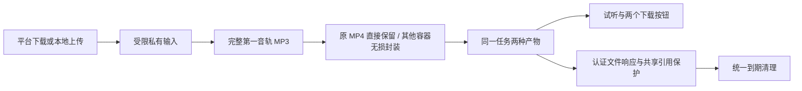

# 原视频 MP4 下载设计

版本：0.1.0。与 [规格](./spec.md) 配套；本补充覆盖原音频设计中“只输出 MP3”“成功删除原视频”的约束。

## Context / Goal / Non-Goal

| 项目 | 说明 |
|---|---|
| 基线 | 已下载或接收完整视频，但生成 MP3 后立即删除输入 |
| 目标 | 同一次处理保存完整 MP4 和 MP3，保持现有音频 API 兼容；MP4 不可用不丢失已完成 MP3 |
| 非目标 | 剪辑、重新编码、视频预览、MP4 系统分享 |

## Architecture

`media.py` 新增 `async prepare_video(source: Path, target: Path) -> float`。

| 环节 | 行为 / 限制 |
|---|---|
| 输入校验 | 大小、实际容器、非attached_pic画面流/声音流及完整时长 |
| MP4 判定 | 探测信息与实际 ftyp 品牌共同确认；不能把 QuickTime MOV 直接改后缀 |
| 视频准备 | 实际 MP4 同目录移动，保留原字节；MOV/WebM 等尝试 FFmpeg `-c copy` 转封装；不截取、不重新编码、不额外下载 |
| 流与元数据 | 映射所有视频与音频流；复制 MP4 支持的源元数据（包括标题和视频旋转信息）；其他容器专属字段不承诺逐字保留 |
| 输出校验 | 视频/音频流数、编码、可确认的各流时长及容器时长；时长容差 max(0.25, min(2, 原秒数×0.005)) 秒，超出即失败 |
| 输出容量 | 输入限额加 1 MiB 封装余量；超限或不完整则删除 MP4，返回安全错误 |
| 完整解码 | 实际 MP4 保留前、其他容器封装后，在处理上限内将全部动态画面流及声音轨完整解码至 null；包括非首轨与默认声音轨，拒绝损坏流，检查不改变交付字节 |
| 子进程 | 复用受限协议和抗重复取消的子进程回收 |

| TaskManager 路径 | 结果 / 清理 |
|---|---|
| 正常 | 先生成 MP3，再准备 MP4 |
| MP4 `MediaError`（`media_timeout` 除外） | 单独降级；删除原输入与部分视频，结果 ready 并保留 MP3 |
| 媒体处理超时 / 整体任务超时 / 取消 | 任务失败或取消并删除全部文件，不作为 MP4 单独降级 |
| 失败 / 取消 / 到期 / 关闭 / 重启 | 清理覆盖两种产物 |
| 任一文件发送 | 计入同一 deliveries |

- `prepare_video` 返回目标 MP4 容器时长（秒）。
- 成功：实际 MP4 的 source 可因移动而消失；重新封装后 source 仍保留，供 TaskManager 删除。
- 失败：保留 source、清理 target；输入与输出相同路径直接拒绝。
- 在 MP4 支持时沿用原流的旋转信息、音轨语言和 default disposition，并纳入真实 MOV 回归；不承诺封装专属或 MP4 不支持的字段。

## Interface Contract

所有新增字段/参数是加法，旧 MP3 URL 和字段不变，沿用 `{detail,code}` 错误格式。

| 接口 / Behavior | 输入与返回 | 边界与幂等性 |
|---|---|---|
| GET /api/tasks/{id} / 提供两种结果 | 原 TaskView 加 video_download_url:string\|null、video_filename:string\|null、video_message:string；仅 ready 且 MP4 已就绪返回视频链接 | 原认证、owner、404 不变；只读 |
| GET/HEAD /files/{id} / 保存原视频 | 新增 `kind: Literal['audio','video']='audio'`，保留 `download:bool=false`；audio 沿用原语义，video 返回 video/mp4 且始终 attachment、UTF-8 .mp4 文件名，支持标准 Range | 401 未认证；404 无权/到期；409 尚未完成或视频不可用（code=video_unavailable）；422 非法 kind；Range 400/416；只读可重试 |

- 本MP4接口继续兼容；创建与取消确认由[审查修复决策](../../../design-docs/arch-review-hardening.md)补充。
- 视频链接 `/files/{id}?kind=video&download=1`，页面继续校验同源 URL。
- 无 MP4 时显示固定可读文案；取消、新任务、到期时移除旧 MP4 链接。

## Data Model

| 项目 | 约定 |
|---|---|
| Task 新增字段 | `video_ready:bool=false`、`video_message:str=''` |
| 文件 | 私有任务目录固定 `audio.mp3` / `video.mp4`；不接受客户端任意路径 |
| 文件名 | 辅助函数允许服务端选择 mp3/mp4 后缀，沿用安全字符和长度限制 |
| 非 ready 状态 | 结果 URL 和文件名为 null |
| 视频不可用 | 不是独立任务失败状态 |

## Non-Functional Requirements

| 维度 | 约束 |
|---|---|
| 容量 | 输入最大 200 MiB，MP4 最大 max_media_bytes + 1 MiB，最多 32 个结果；沿用可配置默认值 |
| 时间 | 两种产物共享 600 秒任务上限、3600 秒保留期与 30 秒清理周期；不承诺额外时延 |
| 安全 | 两种文件共享认证、owner、700 目录/600 文件、受限 FFmpeg 协议和引用计数 |

## Error Handling

| 情况 | 处理 |
|---|---|
| 源下载 / MP3 处理失败 | 整任务失败 |
| MP4 封装不支持 / 封装校验失败 / 存储错误 | 固定文案单独降级；内部异常不输出原始路径、上游内容或 stderr |
| 取消 / 整体超时 | 不能降级为成功 |
| 重新处理 | MP4 不重新抓取；用户可在结果过期后重新处理 |

## Alternatives Considered

| 方案 | 决定 |
|---|---|
| 所有输入改名为 .mp4 | 不选；无法证明实际容器 |
| 所有视频重编码 H.264/AAC | 不选；改变原内容编码、增加 CPU 和处理时间 |
| 已是 MP4 原字节保留，其他无损封装 | 选用；既保留原视频，又明确不支持的编码边界 |

## Testing Strategy

| 对象 | 证据与通过条件 |
|---|---|
| prepare_video | 真实 MP4 输入输出字节一致；真实 MOV 转为 MP4，视频和声音包摘要一致、流数/编码/时长符合上述容差，标题与旋转信息保留；有效首轨但默认次轨损坏时拒绝 MP4；不支持、超限、取消无部分文件 |
| TaskView / 流程 | 两种输入均返回视频字段；MP4 损坏或无法封装时保留有效 MP3；媒体超时、任务超时、取消与到期回收文件；两个交付引用保护 |
| 文件 GET/HEAD/Range | 实际 MP4 内容、类型、attachment、中文安全文件名、206/HEAD/401/其他 owner404/非法 kind422/不可用409；格式错误 Range 400、范围超出文件 416 |
| 页面 | 375px 窄屏与桌面显示两个按钮并实际下载；不可用显示提示；新任务和到期移除旧视频链接；MP3 试听分享行为仍通过 |

## Milestones

1. 媒体准备。
2. 任务及文件交付。
3. 页面及回归检查。
4. 记录工程证据。

真机 MP4 保存/播放另留待验，不覆盖此前已测版本的容器或真机证据。
